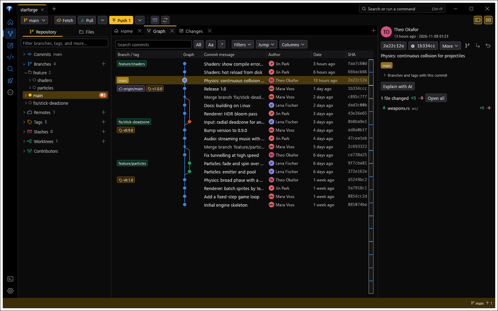

<p align="center">
  
</p>

<h1 align="center">gitem</h1>

<p align="center"><strong>A fast, fearless desktop Git client.</strong><br>
Graph, changes, a repo-aware editor, and its own diff and merge tools, in one native window.</p>

<p align="center">
  <a href="https://ulaas.github.io/gitem/">Website</a> ·
  <a href="#build-from-source">Build</a> ·
  <a href="#features">Features</a> ·
  <a href="LICENSE">MIT License</a>
</p>

<p align="center"></p>

gitem is a desktop Git client written in Rust with [egui](https://github.com/emilk/egui). It runs on Windows, macOS and Linux, starts fast, and does everything through the `git` you already have, so what it does is what git does, and every command it runs is in its Console.

> gitem was developed entirely with AI, with a hint of human taste.

## Features

**History**
- A commit graph with lanes you can fold, ref badges, search with highlights, favourites, a minimap, columns you can drag, resize and hide, and a work-in-progress row.
- Blame, heatmap and change annotations in the file view, recent-change summaries above symbols, and Older / Newer through a file's history across renames.
- File and line history, a visual history of a file, folder, branch or the whole repository, treemaps, and contributors.
- Search of commit messages, authors, files and changes with a small query language, `git grep` across the tree at any revision, and compare of any two refs.

**Changes and commits**
- Files, diff and commit message on one screen. Stage by file, hunk or line, from a list or a tree, with buttons on the row under the pointer to open, discard or stage it.
- A Composer that splits work into several commits, reword, squash, fixup, drop, revert, cherry-pick, and Undo for merges, rebases, resets, discards and branch deletes.
- An interactive rebase editor with drag to reorder and a conflict check before anything runs.

**Editor (IDE mode)**
- Turn on IDE mode from the rail and a click in the Files tree opens the file for editing: syntax colours, several carets, find and replace, folding, word wrap, a minimap, and an outline of the file's definitions.
- It knows the repository: marks beside each line for what changed against the index and HEAD, stage or revert one change from the gutter, blame through unsaved edits, and a warning before a checkout or pull would overwrite your edits.
- Line endings, byte order marks, UTF-16 and Windows-1252 are kept as they were.

**Diff and merge**
- Side-by-side and unified diffs with word-level changes, syntax colours and image comparison.
- A three-pane merge tool (ours, result, theirs, and base if you want it) with per-conflict choices and inline editing.
- Both also work as git's own `difftool` and `mergetool`.

**Branches, remotes and hosts**
- Branches, tags, remotes, stashes and worktrees in the sidebar; fetch, pull and push with the exact command shown before anything destructive.
- Pull requests and issues for GitHub, GitLab, Bitbucket, Azure DevOps and Gitea / Forgejo, self-hosted included: review, comment, approve, merge, and check out with follow-up updates. Jira, Linear and Trello issues too.
- Clean-up of merged branches, fast-forward of branches you aren't on, and a git-flow style branch model if you want one.

**AI assistance, your own provider**
- Commit messages, explanations, review, conflict resolution, natural-language search and changelogs, through Anthropic, OpenAI, Gemini, Mistral, OpenRouter or any OpenAI-compatible server such as Ollama.
- Only when you ask, only to the provider you chose, and never for files listed in `.aiignore`, `.cursorignore` or `.aiexclude`.

**Repository tools**
- Reflog recovery, guided bisect, submodules, hooks, Git LFS, sparse checkout, `.gitignore` editing, clean with a preview, maintenance and a config editor.
- A credential manager for host tokens, git HTTPS credentials and SSH keys.

**The window**
- Dockable tabs with two built-in layouts (Git and IDE) and your own, a command palette (`Ctrl+P`) that reaches everything, an icon rail you can arrange, twelve themes and any accent colour, colour-blind safe diffs and reduced motion.

## Build from source

You need the Rust toolchain (stable) and **git 2.38 or newer** on the machine.

```sh
cargo build --release
target/release/gitem [path-to-repository ...]
```

On Linux, install the development packages for the windowing libraries first, for example `libxkbcommon-dev libwayland-dev` on Debian and Ubuntu.

- `cargo build --profile dist` makes a smaller binary in `target/dist`, and takes longer.
- `--features tree-sitter` gives the editor's outline and folding real syntax trees for Rust, Python, JavaScript and Go. It needs a C compiler.
- `packaging/` has scripts for a Windows installer and a Linux AppImage. See [packaging/README.md](packaging/README.md).

With no path, gitem reopens the repositories from your last session.

### Which git it uses

1. The path set in **Settings > General**.
2. A `git/` folder beside the gitem binary (also `mingit/` or `PortableGit/`), for a self-contained copy.
3. `PATH`.
4. The standard install folders.

## Command line

```
gitem [PATH ...]                             open repositories
gitem --difftool LEFT RIGHT                  as git's difftool
gitem --mergetool BASE LOCAL REMOTE MERGED   as git's mergetool
gitem --rebase-editor TODO-FILE              as git's sequence.editor
gitem --edit-file FILE                       as git's core.editor
gitem --credential-helper get|store|erase    as git's credential helper
gitem --mcp [PATH]                           read-only MCP server for coding agents
gitem gitem://open?repo=PATH&commit=SHA      open a link
gitem --version
```

**Credentials > Git integration** registers these with git for you.

## Keyboard

`F1` lists every key in the app, with a search box, and **Settings > Workflow** changes them.

| Keys | Action |
|---|---|
| `F1` | List these shortcuts, with a search box |
| `Ctrl+P` | Command palette |
| `Ctrl+Shift+G` | Changes |
| `Ctrl+Shift+H` | Graph |
| `Ctrl+B` | Toggle sidebar |
| `F5` | Refresh |
| `Ctrl+O` | Open a folder |
| `Ctrl+,` | Settings |
| `Ctrl+W` | Close the tab, asking first if that loses something |
| `Ctrl+Tab` `Ctrl+Shift+Tab` | Next and previous tab in the pane |
| `Ctrl+1` to `Ctrl+9` | Go to that repository |
| `Ctrl+Shift+F` `Ctrl+Shift+L` `Ctrl+Shift+K` | Fetch, pull, push |
| `Enter` | Submit a dialog from a one-line field; answer a question that loses nothing |
| `Ctrl+Enter` | Submit the open form. With none open, or from the commit box, commit |
| `Esc` | Close a dialog or menu |
| `Tab` | Move between controls. What has the keyboard gets an outline |
| `Shift+F10` | Open the menu of the current row, in Changes and the graph |
| `↑ ↓` | Move through the files in Changes, or the commits in the graph |
| `Ctrl+click` | Pick several branches in the sidebar, to delete together |
| `J` `K` | Next and previous commit in the graph |
| `Space` | Stage or unstage the current file in Changes |
| `Alt+↑, Alt+↓` | Previous and next change in a diff |
| `Alt+Up, Alt+Down` | Move a commit in the rebase editor |
| `P` `R` `E` `S` `F` `D` | Set the rebase action |
| `Ctrl+F` | Find in a file or a diff; search in the graph |
| `/` | Find a ref in the graph |
| `F3` `Shift+F3` | Next and previous search match |
| `Alt+B` | Toggle blame in a file |
| `Ctrl+Shift+E` | IDE mode on or off: a click in the Files tree opens the file for editing |
| `Ctrl+S` | Editor: save |
| `Ctrl+Shift+M` | Fill the window with this pane, or bring the layout back |
| `F6`, `Shift+F6` | Next and previous pane |
| `Ctrl+K`, then an arrow | Go to the pane that way |
| `Ctrl+H`, `Ctrl+G` | Editor: replace, go to line |
| `Ctrl+Shift+O` | Editor: go to a definition in this file |
| `Ctrl+D`, `Ctrl+F2` | Editor: select the next match, or all of them, for typing in several places |
| `Ctrl+Shift+Up`, `Ctrl+Shift+Down` | Editor: add a caret above or below |
| `Alt+Up`, `Alt+Down` | Editor: move lines, or with Shift copy them |
| `Ctrl+/`, `Ctrl+L`, `Ctrl+J` | Editor: toggle comments, select the line, join lines |
| `Ctrl+Shift+[`, `Ctrl+Shift+]` | Editor: fold the block at the caret, unfold it. The gutter's carets do the same |
| `Alt+Z` | Editor: word wrap on or off |
| `Ctrl+Shift+Z` | Zen mode |
| `Ctrl+Alt+Z` | Undo the last action |

## Words

The same words are used throughout, and F1 lists them too.

| Word | What it means |
|---|---|
| Check out | Make a branch or commit the one you're on. Git's `switch` |
| Changes | What you've edited and not committed. Unstaged until you stage it |
| Stage | Add to what the next commit holds |
| Graph | The history, with its branches drawn as lanes |
| Details | The panel about the selected commit |
| Launchpad | Pull requests and issues on the repository's host |
| Review | Your own notes on a diff. Review with AI adds to them |
| Compose | Split uncommitted changes into several commits, in the Composer |
| Recompose | The same for commits you've already made |
| Rebase | Replay commits on another base, or edit them. Git's `rebase -i` |
| Upstream | The remote branch a branch follows, for its counts, Pull and Push |
| Patches | A local library of saved changes |

## Safety

gitem treats repositories as untrusted, because a folder can arrive with a `.git` that names programs to run.

- Before the first read of a repository, gitem looks for config that would run a program (filters, diff and merge drivers, `core.fsmonitor`, `credential.helper` and others), names it, and asks. Until you agree, those stay off. Reads never run hooks.
- Destructive commands ask first and show the exact git command. Force with lease adds `--force-if-includes`, and any force push of the default branch asks, lease or not.
- Tokens and passwords live in the Windows Credential Manager, or a private file (mode 0600) elsewhere, and are masked wherever a URL is shown.
- Nothing is sent anywhere unless you ask: no telemetry, an update check that's off by default and only links to a release page, and AI requests only to the provider you configured.
- A crash writes a local report and offers it to you on the next launch. Nothing leaves the machine.

To report a vulnerability, see [SECURITY.md](SECURITY.md).

## What hasn't been tried for real yet

The test suite runs real git against temporary repositories and local bare remotes, and clicks through the interface headlessly. Hosting, issue-tracker and AI integrations are tested against a local mock server, not the real services, so try them with your own accounts before relying on them. The Windows installer, the AppImage and the release workflow have not been run, and nothing is code-signed.

## Project layout

```
crates/gitem-core   everything but the UI: git runner, parsers, operations, diff and merge
                    engines, graph layout, hosts, credentials, AI
crates/gitem-text   the editor's text model: rope buffer, selections, edits, undo
crates/gitem        the egui app, its views, and git's helper modes
docs/               the project's website, served by GitHub Pages
```

`cargo test --workspace` runs the tests. Every test binary gets its own scratch git config, settings and home folder, so nothing touches your real profile. See [CONTRIBUTING.md](CONTRIBUTING.md).

## License

gitem is under the [MIT License](LICENSE). It's built on open-source crates and fonts under their own licenses, listed in [THIRD-PARTY-NOTICES.md](THIRD-PARTY-NOTICES.md).
